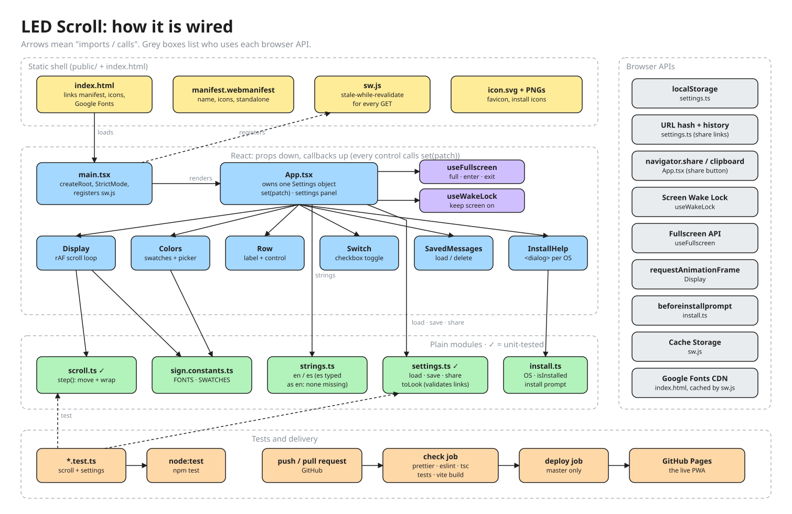

# LED Scroll

Turn a phone into a scrolling LED sign. Installable on iOS and Android as a PWA, in Spanish and English.

**Live:** https://oficinamentaldebruno.com/ledscroll/ · https://gerardoleon.dev/ledscroll/ (both served from https://elparaquecosadeque.github.io/ledscroll/)

## Run locally

```sh
npm install
npm run dev       # open the printed network URL on your phone
npm run check     # format, lint, type check, unit tests
npm run build && npm run preview   # production build; the service worker only runs here
```

## How it is wired



Editable source: [`docs/architecture/wiring.excalidraw`](docs/architecture/wiring.excalidraw) (open it at excalidraw.com).

Pushing to `master` deploys to GitHub Pages. The two custom domains are a Cloudflare Worker ([`cloudflare/ledscroll-proxy.js`](cloudflare/ledscroll-proxy.js)) that forwards `/ledscroll/*` to Pages, so nothing else needs deploying. Conventions: [`CODE_STYLE.md`](CODE_STYLE.md), [`STACK.md`](STACK.md), [`CLAUDE.md`](CLAUDE.md).
